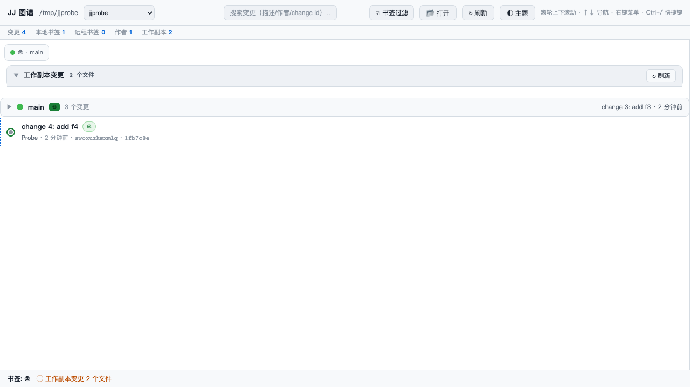

# dsh-jj-graph

> DSH 插件：DeepSeek Harness Web GUI 里的**只读** Jujutsu（jj）变更图谱。
> A read-only Jujutsu change graph for the DeepSeek Harness Web UI.

参考 [`dsh-git-graph`](https://github.com/1841220388zzzcccxxx-star/dsh-git-graph) 的插件形态与图形页面实现，把数据层从 `git` 换成 `jj`。
会话视图里多出一个「JJ 图谱」标签页：变更图谱、书签过滤、逐变更 diff、工作副本面板。



## 功能

| 区域 | 说明 |
|---|---|
| 智能显示 | **只在当前会话的工作区是 jj 仓库时才出现这个标签页**；colocated 仓库（`.jj` 与 `.git` 并存，你三个 jj 仓库都是）算 jj，里 sibling 的「Git 图谱」会自动让位。判断失败一律回退成"显示"，见下 |
| 仓库发现 | 自动采用当前会话工作区（向上找 `.jj`）；顶栏「📂 打开」可浏览磁盘添加任意 jj 仓库；内存态允许列表在 dsh 重启后由页面重新注册 |
| 变更图谱 | `jj log -r 'all()'`，自绘泳道图；`@`（工作副本）用绿色环标记；分页每次 200 条 |
| 书签过滤 | 本地书签 / 远程书签分别成组，可折叠、可勾选过滤；`main@origin` 之类远程书签单独着色 |
| 变更详情 | 点击任一变更 → 元信息（**变更 ID** / 提交 ID / 作者 / 时间 / 父变更）、完整描述、`--stat`、完整 patch |
| 单文件 diff | 详情面板里点文件 → 该变更中此文件的 diff；右键文件可看该文件的变更历史 |
| 工作副本面板 | `@` 的全部改动（jj 没有暂存区，所以是**一个**分组），逐文件 +/− 计数，点击展开该文件的 diff |
| 搜索 | 描述 / 作者 / 邮箱 / change id / commit id |
| 主题 | 「自动」跟随 Harness 界面浅色/深色（读取 `body[data-ds-dark-theme]`，属性存在=深色），并随壳层实时切换；另有 8 套配色预设 |

## 智能显示（标签页按会话工作区出现）

`conversation.view` 的注册是**全局列表**：壳层 `viewTabs()` 遍历 `slots.entries()`，没有可见性谓词（唯一的内建过滤是硬编码的 `trajectory` + developerTools）。但 tab 条和它显示的会话都在 conversation header 里，所以在
`conversation.session.header.utilities`（`list` / session 作用域，恰好与 tab 同时渲染）挂一个**不可见探针**上报当前会话 cwd，插件据此注册或注销自己的 view 条目：

- Host 侧 `op=probe&ws=<cwd>`：只做 stat 向上探测，同时报告 `.jj` 与 `.git`，不起 jj 进程。
- Client 侧规则：**jj 插件** 可见 ⟺ `jj === true`；**git 插件** 可见 ⟺ `git === true && jj !== true`（colocated 时 jj 优先）。
- **任何信息缺失都保持可见**：无会话、无 cwd、probe 报错 / 超时 / 回复不合法 → 显示。也就是说这个特性最坏是"该藏的没藏掉"，**不会把 tab 弄丢**。
- 跨会话切换：不同工作区的会话之间切换时，tab 会跟着出现/消失（这是它的设计意图）。若某个会话当前正停在已消失的 tab 上，壳层的 `resolveActiveView` 会兜底回「对话」，不会白屏。

`test/client.test.mjs` 用桩容器把上面每条规则都钉住了（含乱序回复、网络失败、无 cwd、同一 cwd 去重）：

```sh
node test/client.test.mjs
# 顺带校验打了同样补丁的 git 插件：
GIT_GRAPH_CLIENT=~/.dsh/profiles/desktop/node_modules/dsh-git-graph/client.js node test/client.test.mjs
```

## 只读保证

这个插件**不提供任何写操作**：没有 `jj describe` / `jj commit` / `jj abandon` / `jj git push` 的按钮，Host 半也**不注册任何会改仓库的 op**（`gitop` 之类一律 404）。

纯读 op（`graph` / `branches` / `show` / `diff` / `filediff` / `filelog` / `remoteinfo`）都带 `--ignore-working-copy`，所以**打开页面不会快照工作副本、不会往 `jj op log` 里追加操作**。

只有 `workstatus` / `workfile`（必须反映工作副本当前状态）允许 jj 正常快照——和你在终端敲 `jj status` 的行为一致。

这条保证有测试兜底：`test/ops.test.mjs` 会在每个纯读 op 前后比对 `jj op log` 的条目数，多一条就 FAIL。

## 环境要求

- `jj` ≥ 0.45（开发与测试基于 0.45.1）；`jj` 必须在 DSH 宿主进程的 `PATH` 上
- DSH（DeepSeek Harness）桌面版；插件按 bundle 形态安装进 profile

## 安装

插件是标准的 DSH bundle（`package.json` 声明 `dsh.bundle.patch`、`dsh.client`）。两种装法：

1. **创造模式的 Plugin Manager**（推荐）：
   ```js
   plugin_manager({ action: "install_bundle", target: "/绝对路径/refining/dsh-jj-graph" })
   ```
2. **Web 侧边栏「插件」页**：安装 bundle，目标填本仓库的绝对路径；安装后在会话视图里切到「JJ 图谱」。

装完不需要重启（在线 profile 会重新组合、Client bundle 走 HMR）；若页面没出现，重载一次窗口。

## 本地验证

```sh
# Host 半：51 项断言，含只读保证、仓库类型探测、参数注入拒绝、逐文件行完整性
# （自建 scratch 仓库，不碰你的仓库）
node test/ops.test.mjs

# Client 半：15 项断言，钉住标签页的显示规则与 fail-safe（桩容器，无需启动 Harness；
# 带上 GIT_GRAPH_CLIENT 同时校验 git 插件时为 30 项）
node test/client.test.mjs

# 页面：DOM 复刻壳层 + 真实 handler，断言主题跟随 / 输入框隐藏 / 审批面板保留 /
# 工作副本面板逐文件成行（A/M/D 三种形状，删除行也要显示文件名）
node tools/verify-ui/serve.mjs --repo <一个 jj 仓库> --port 8981   # 然后开 http://127.0.0.1:8981/
node tools/verify-ui/check.mjs --repo <一个 jj 仓库>               # 自动跑完全部场景
```

## 设计要点

- **数据抽取**：所有字段都经 jj 模板的 `json()` 输出、用真实 Tab 分隔，再逐段 `JSON.parse`。
  jj 模板语言没有 `\x1f` 转义、也没有列表字面量（`[a, b]` 会语法错误），`json()` 会把值里的
  Tab/换行/引号转义掉，因此描述里出现任何字符都不会错列。
- **没有暂存区**：jj 的工作副本本身就是一个 commit（`@`），所以面板只有一个分组；页面里
  git 时代的暂存/批量操作代码整块删除，而不是留着等运行时报错。同理，分组可见性也不再看
  那张 git 时代的 `WD_SHOW`（键是 `staged`/`unstaged`/`untracked`，而 jj 的分组键是
  `changes`）：v0.2.0 里它按 `changes` 查永远命中不到，于是计数照显示、文件行整组被跳过。
- **删除行只有 `--- a/<path>` 这一个来源**：`+++` 是 `/dev/null`，所以解析器把 a/ 侧先记成
  候选、由 `+++` 决定它是"文件本名"还是"重命名来源"；`oldPath` 只在 rename/copy 时非空，
  修改不再把自己的名字重复一遍，删除行也不会渲染成空路径。
- **文件集合由 jj 说了算，patch 只供计数**：`jj diff --git` 是展示格式，二进制、空文件、
  纯 mode 变更**根本没有** `---`/`+++` 行，靠它反推路径就会整条丢（v0.2.1 实测 5 个变更只
  回 1 行）。现在行集合来自 diff 模板（`status`/`path`/`source.path()`，JSON 转义），
  `--git` patch 只按路径挂 `+/-` 计数，因此文件名里有换行也不会漏行。
- **HTTP 输入不进 jj 的全局参数位**：revision 一律绑成 `--revision=<v>` / `--revisions=<v>`，
  路径一律写成 `file:"<path>"` 字面量。否则 `hash=--config-file=/outside.toml` 会被 jj 的
  全局参数预解析吃掉、读到仓库外文件并在报错里回显其内容；`file=glob:a` 会被当成 fileset
  模式（读到空 diff 或整个仓库）。
- **书签 ≠ 分支**：`jj bookmark list --all-remotes` 还会列出 git 后端的合成远程 `git`，
  真远程另有其人——插件用 `jj git remote list` 的结果过滤，只保留真实远程。
- **根提交**：jj 的 `root()`（全 0 commit id）不出现在图里，`total` 用 `(revset) ~ root()` 计数，
  所以分页总数和实际行数一致。
- **绝对路径**：所有 jj 调用都 `cwd = 仓库根`，因为 jj 的 pathspec / `files()` 是相对**进程工作目录**
  而不是仓库根解析的。

## 已知限制

- 只读：改历史、建书签、推送都要回终端用 `jj`。
- **只读的边界**：仓库不处于「并发 operation 分叉」时，插件不追加任何 operation（测试逐 op
  断言）。但仓库一旦有多个 operation head（两个 jj 进程并发写过），**任何** jj 命令都会触发
  jj 自身的 `reconcile divergent operations` 并新增一条 op —— 本插件的读也一样（隔离实测：
  读一次图谱，heads 2→1、op 数 +1）。这是 jj 的自动修复行为，插件不额外写任何东西，但也因此
  「读绝不改动仓库」这句话在分叉态下不成立。
- 单仓库视图：一次只显示一个仓库（顶栏可切换）。
- 智能显示只做到「按当前会话的工作区」：同一次会话里跨仓切换需要顶部「📂 打开」换仓库，tab 本身不跟着换。
- 大仓库：`all()` 全量取；页面按 200 条分页，但 `total` 需要一次完整 revset 遍历（有 5 秒缓存）。
- 不显示 jj 的 `divergent` / `hidden` 特殊状态，也不画 jj 自带的图（自绘泳道）。

## 回滚

在侧边栏「插件」页停用或删除该 bundle；或从 profile 的 `package.json` / `cordis.patch.yml` 里移除相关行。
仓库本身无副作用：插件只在内存里维护「最近使用过的仓库」列表。

## License

MIT
